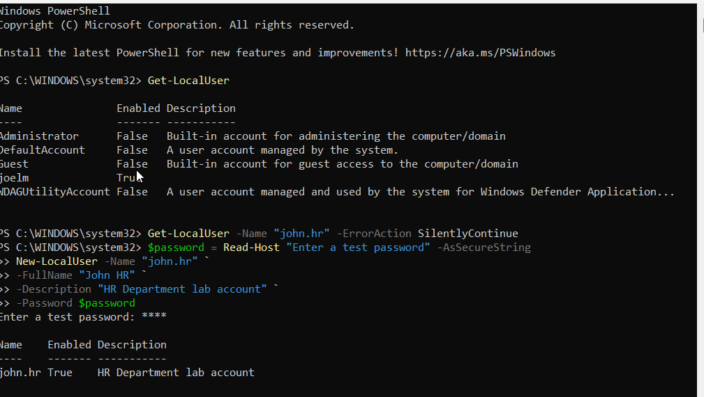
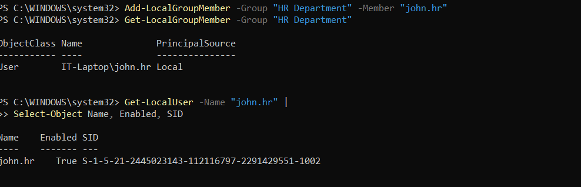

# Windows Local Users and Groups

**Module:** Windows Endpoint Foundations  
**Topic:** Local Users and Groups  
**Lab type:** Hands-on administration  
**Environment:** Windows VM running in VirtualBox  
**Status:** In progress

---

## 1. Objective

Learn how to create and manage local Windows user accounts and groups using PowerShell.

By the end of this lab, I should be able to:

- Identify existing local user accounts.
- Create a local user account.
- Create a local security group.
- Add a user to a group.
- Verify group membership.
- Understand the purpose of a Security Identifier (SID).
- Explain why organisations use groups to manage permissions.

## 2. Why This Matters in Enterprise IT

In an organisation, employees need accounts to access computers and company resources.

Administrators use user accounts to identify individuals and groups to organise users and manage access.

For example, an organisation might have:

| User | Department | Group |
|---|---|---|
| John | HR | HR-Department |
| Sarah | HR | HR-Department |
| Peter | IT | IT-Department |
| Mary | Finance | Finance-Department |

Instead of assigning permissions to every employee individually, administrators can assign permissions to groups.

This simplifies administration and makes employee onboarding and offboarding easier.

## 3. Technical Concepts

### Local User Account

A local user is an account created and managed on an individual Windows computer.

Windows stores local account information in the Security Accounts Manager (SAM).

### Local Group

A local group is a collection of user accounts that can be managed together.

Groups help administrators assign permissions to multiple users efficiently.

### Security Identifier (SID)

A SID is a unique identifier Windows uses to identify security principals such as users and groups.

Windows uses SIDs when evaluating permissions and access.

### Security Accounts Manager (SAM)

SAM is the Windows component responsible for managing local account information.

### Least Privilege

Users should only receive the permissions necessary to perform their jobs.

For example, an HR employee should not automatically receive local administrator privileges.

## 4. Practical Lab — Create a Local HR User

### Step 1: Inspect Existing Users

Command:

```powershell
Get-LocalUser
```

Purpose:

Lists the local user accounts configured on the computer.


### Step 2: Check Whether John Already Exists

Command:

```powershell
Get-LocalUser -Name "john.hr" -ErrorAction SilentlyContinue
```

Purpose:

Checks whether the account already exists before attempting to create it.

### Step 3: Create the HR User

Commands:

```powershell
$password = Read-Host "Enter a test password" -AsSecureString

New-LocalUser -Name "john.hr" `
-FullName "John HR" `
-Description "HR department lab account" `
-Password $password
```

Purpose:

Creates a local Windows account for the fictional HR employee.

**Result:**

[Record whether the account was created successfully.]


### Step 4: Create the HR Department Group

Command:

```powershell
New-LocalGroup -Name "HR-Department" `
-Description "HR department lab users"
```

Purpose:

Creates a local security group for HR employees.

**Result:**

[Record the result.]

### Step 5: Add John to the HR Group

Command:

```powershell
Add-LocalGroupMember -Group "HR-Department" -Member "john.hr"
```

Purpose:

Adds John to the HR department group.

### Step 6: Verify Group Membership

Command:

```powershell
Get-LocalGroupMember -Group "HR-Department"
```

Expected result:

The account `john.hr` should appear as a member of the group.


### Step 7: Inspect John's SID

Command:

```powershell
Get-LocalUser -Name "john.hr" |
Select-Object Name, Enabled, SID
```

Purpose:

Displays the account name, enabled status and Security Identifier.


## 5. Troubleshooting

### Scenario: User Account Already Exists

If Windows reports that the account already exists, inspect the existing account before attempting another creation.

```powershell
Get-LocalUser -Name "john.hr"
```

### Troubleshooting Notes

| Problem | Investigation | Resolution |
|---|---|---|
| Account already exists | Inspect using Get-LocalUser | Reuse or investigate existing account |
| Access denied | Check PowerShell privileges | Run PowerShell as Administrator |
| Group not found | Inspect local groups | Verify the group name |
| User not found | Inspect local users | Verify the account name |

**Problems encountered during my lab:**

[Record actual errors and how they were resolved.]

## 6. Enterprise Application

In a real company, administrators use groups to manage employee access.

For example:

- HR employees belong to HR-Department.
- Finance employees belong to Finance-Department.
- IT employees belong to IT-Department.

Permissions can then be assigned to the appropriate groups instead of individual employees.

This is particularly useful when employees join, change departments or leave the organisation.

**Important:** This lab uses local Windows accounts. Enterprise Active Directory accounts will be covered in a later module.

## 7. Security Considerations

- Follow the principle of least privilege.
- Do not make ordinary employees local administrators unnecessarily.
- Use strong, unique passwords for lab accounts.
- Remove or disable accounts when they are no longer required.
- Review group membership regularly.

## 8. Knowledge Check

1. What is the difference between a local user and a domain user?
2. Why do administrators create groups?
3. What is a SID?
4. What is the purpose of SAM?
5. What does least privilege mean?

## 9. Lab Completion

- [ ] Inspected existing local users.
- [ ] Created the John HR account.
- [ ] Created the HR-Department group.
- [ ] Added John to the group.
- [ ] Verified group membership.
- [ ] Inspected John's SID.
- [ ] Captured screenshots.
- [ ] Documented observations.
- [ ] Completed the knowledge check.

**Final status:** In progress

## 10. What I Learned

[Write a short explanation in your own words about what you learned and why it matters.]
So what i learned today is local users are in ine computer. And before doing anything else you first have to check any existsing users then can start anything else.

## Screenshots




## References

- Microsoft Learn — [Get-LocalUser](https://learn.microsoft.com/en-us/powershell/module/microsoft.powershell.localaccounts/get-localuser)
- Microsoft Learn — [New-LocalUser](https://learn.microsoft.com/en-us/powershell/module/microsoft.powershell.localaccounts/new-localuser)
- Microsoft Learn — [New-LocalGroup](https://learn.microsoft.com/en-us/powershell/module/microsoft.powershell.localaccounts/new-localgroup)
- Microsoft Learn — [Add-LocalGroupMember](https://learn.microsoft.com/en-us/powershell/module/microsoft.powershell.localaccounts/add-localgroupmember)
